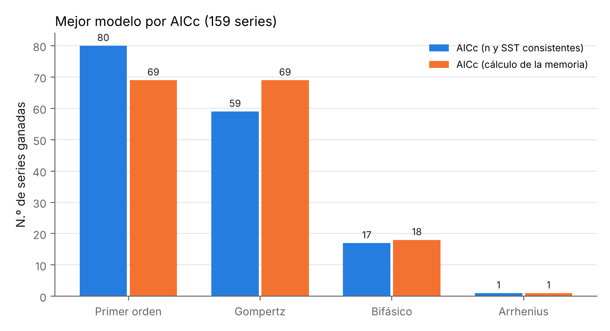
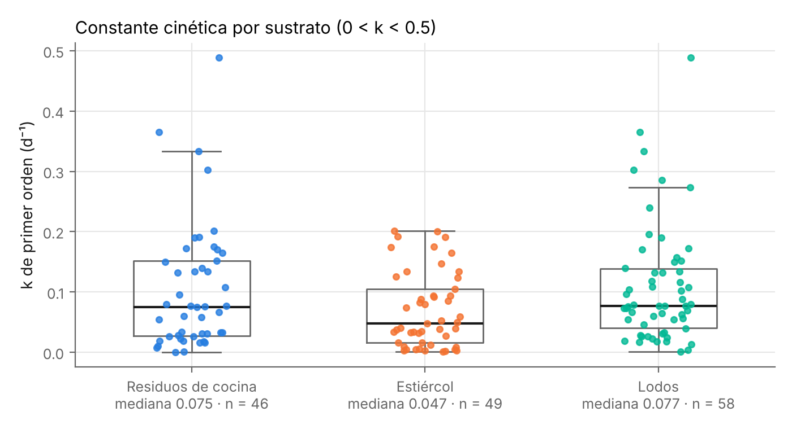
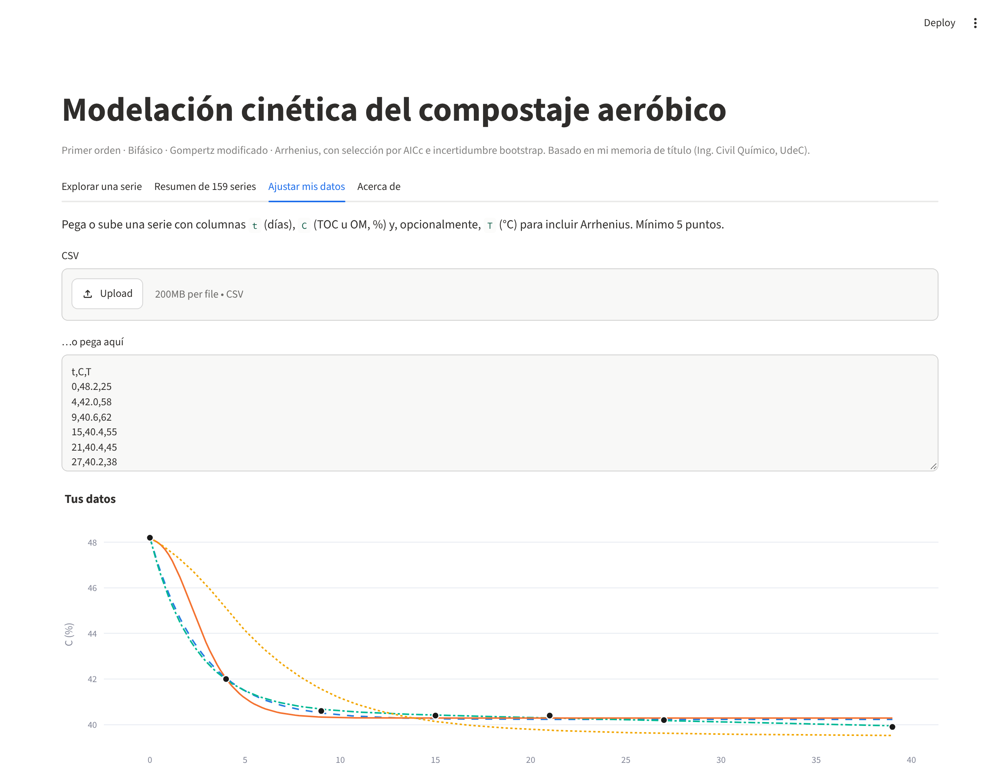

# Cinética del compostaje aeróbico

> Ajusta cuatro modelos cinéticos a curvas de degradación de compost, elige el mejor por AICc y estima la incertidumbre de sus parámetros, para dimensionar el tiempo de residencia de un reactor de compostaje.

[](https://github.com/vmunozicq/compostaje-cinetica/actions/workflows/ci.yml)
[](LICENSE)


**English summary.** Reproducible re-implementation of my chemical engineering thesis (Universidad de Concepción, 2025). It fits first-order, biphasic, modified Gompertz and non-isothermal Arrhenius kinetics to 159 composting series from a public dataset, ranks them by AICc and gives bootstrap confidence intervals for the rate constants. The code reproduces the thesis results exactly (same 159 series, R² identical to 10⁻⁶). Re-running it also exposed two errors in the original analysis, documented in [`docs/supuestos.md`](docs/supuestos.md).

---

## 1. Problema

Para dimensionar un reactor o una pila de compostaje se necesita saber cuán rápido se degrada la materia orgánica de cada sustrato, y cuán confiable es esa velocidad. En la práctica se toma una constante de primer orden de algún artículo sin revisar si ese modelo describe bien el sustrato. Esta herramienta compara cuatro modelos sobre datos reales de residuos de cocina, estiércol y lodos. Elige el modelo con un criterio que penaliza los parámetros de más y entrega intervalos de confianza para diseñar de forma conservadora.

## 2. Modelo

C es el carbono orgánico total (TOC) o la materia orgánica (OM), en % base seca. C₀ es el primer dato medido y C∞ la fracción no degradable.

| Modelo | Ecuación | Parámetros (p) |
| --- | --- | --- |
| Primer orden | C(t) = C∞ + (C₀ − C∞) e^(−k t) | k, C∞ (2) |
| Bifásico | C(t) = C∞ + (C₀ − C∞) [f e^(−k₁ t) + (1 − f) e^(−k₂ t)] | k₁, k₂, f, C∞ (4) |
| Gompertz modificado | Y = C₀ − C = P exp{−exp[(Rm e / P)(λ − t) + 1]} | P, Rm, λ (3) |
| Arrhenius no isotérmico | dC/dt = −A exp(−Eₐ / R T(t)) · (C − C∞) | A, Eₐ, C∞ (3) |

| Símbolo | Significado | Unidad |
| --- | --- | --- |
| t | tiempo de compostaje | d |
| k, k₁, k₂ | constantes de degradación | d⁻¹ |
| Rm, λ | velocidad máxima y fase de latencia (Gompertz) | %·d⁻¹, d |
| A, Eₐ | factor preexponencial y energía de activación | d⁻¹, J·mol⁻¹ |
| T(t) | temperatura medida, interpolada linealmente | K |

**Ajuste.** Mínimos cuadrados no lineales con cotas: `curve_fit` (Trust Region Reflective) para los tres primeros modelos y L-BFGS-B sobre el ODE para Arrhenius.

**Selección.** AICc = n ln(SSE/n) + 2p + 2p(p + 1)/(n − p − 1). Solo compiten los modelos con R² > 0 y n > p + 1.

**Incertidumbre.** Bootstrap de pares, B = 1000. Se informa el IC 95 % por percentiles.

Fuentes: Saldarriaga et al. (2018) e Ibrić et al. (2021) para primer orden; Zwietering et al. (1990) para Gompertz. El detalle está en [`docs/modelo.md`](docs/modelo.md).

## 3. Supuestos y límites

- Humedad y oxígeno no son limitantes, así que la cinética depende solo de t, C y T.
- TOC u OM representan el sustrato degradable. Se usa TOC si la serie tiene al menos 5 datos de TOC.
- Filtro de calidad por punto: T entre 10 y 75 °C, humedad entre 30 y 75 %, pH entre 5,5 y 9, y C/N entre 8 y 40. Cada serie necesita al menos 5 puntos y una variación de al menos 2 puntos porcentuales.
- Errores homocedásticos e independientes.
- **No cubre** transferencia de calor y masa, aireación, balance de agua ni cinética microbiana explícita. Tampoco predice fuera del rango de los datos.
- **Datos públicos.** Se usa el [Compost Dataset](https://github.com/1191600618/Compost-Dataset) (Zhang et al., 2025, *Waste Management* 205, 114981), con licencia MIT y fijado a un commit con verificación SHA-256. Ver [`SOURCES.md`](SOURCES.md).

Las diferencias entre el texto de la memoria y los scripts que generaron sus resultados están en [`docs/supuestos.md`](docs/supuestos.md). Cuando difieren, el código sigue a los scripts. Las decisiones abiertas están marcadas como `TODO(Vicente)`.

## 4. Validación

El caso de validación consiste en reproducir los resultados de mi memoria con el mismo dataset. Sus tablas originales están en `data/reference/`.

| Variable | Memoria | Este código | Diferencia |
| --- | ---: | ---: | --- |
| Series tras filtro físico | 417 | 417 | 0 |
| Puntos tras filtro físico | 3.362 | 3.362 | 0 |
| Series ajustables | 159 | 159 | mismos ID |
| R² primer orden, bifásico y Gompertz | 159 series | 159 series | < 10⁻⁶ |
| k de primer orden | 159 series | 159 series | < 10⁻⁵ |
| Ganadores AICc (cálculo original) | 71 / 69 / 18 / 1 | 69 (+2 sin ajuste) / 69 / 18 / 1 | ver nota |

El test que lo verifica es [`tests/test_validacion.py`](tests/test_validacion.py). El orden de los ganadores es primer orden / Gompertz / bifásico / Arrhenius.

Nota: el script original rotulaba como "primer orden" a las 2 series sin ningún ajuste válido. Aquí aparecen como "Ninguno".

### Lo que encontré al reproducirla

**El AICc de la memoria mezclaba dos versiones de cada serie.** El R² venía del ajuste con los datos filtrados, pero N y SST venían de la serie sin filtrar. Ocurre en 54 de 159 series. Con un cálculo consistente, el primer orden gana con más claridad:

| Mejor modelo | AICc consistente | Cálculo de la memoria |
| --- | ---: | ---: |
| Primer orden | 80 | 69 (+2) |
| Gompertz | 59 | 69 |
| Bifásico | 17 | 18 |
| Arrhenius | 1 | 1 |

La conclusión de la memoria se mantiene: ningún modelo es universal.

**El bootstrap numeraba las series de otra forma.** El script no eliminaba una fila sin tiempo, así que la "25_1" de la figura de incertidumbre era otra serie. Con la numeración correcta, la 25_1 tiene k = 0,34 d⁻¹ (IC 95 %: 0,17 a 0,39).




## 5. Demo

La app tiene cuatro pestañas:

- **Explorar una serie**: elige un sustrato y una serie, compara los cuatro ajustes y calcula el IC 95 % de k, Rm y λ con bootstrap.
- **Resumen de 159 series**: ganadores por criterio y distribución de k por sustrato.
- **Ajustar mis datos**: pega un CSV con `t`, `C` y opcionalmente `T`, y obtén los cuatro ajustes con su AICc.
- **Acerca de**.

| Resumen | Ajustar mis datos |
| --- | --- |
|  |  |

### Ejecutar en local

```bash
git clone https://github.com/vmunozicq/compostaje-cinetica.git
cd compostaje-cinetica
python -m venv .venv && source .venv/bin/activate
pip install -r requirements.txt -r requirements-dev.txt
pytest
streamlit run app/streamlit_app.py
```

Para regenerar todos los resultados y figuras (unos 2 minutos):

```bash
python scripts/run_pipeline.py --boot 1000
```

## 6. Estructura

```
src/compostaje/   núcleo: datos, modelos, métricas, ajuste, bootstrap (sin Streamlit)
app/              interfaz Streamlit
scripts/          pipeline que genera results/ y docs/figuras/
tests/            pytest: unidades + reproducción de la memoria
data/raw/         Compost Dataset tal como se descargó (ver SOURCES.md)
data/reference/   tablas originales de la memoria, para validar
results/          ajustes por serie, ganadores y bootstrap
docs/             modelo, supuestos y discrepancias, figuras
```

## 7. Hecho con Claude Code

Este es un proyecto personal. El modelo es mío: las ecuaciones, los supuestos y los filtros vienen de mi memoria de título y de los scripts con que la hice ([`docs/modelo.md`](docs/modelo.md)). [Claude Code](https://claude.com/claude-code) reescribió ese análisis como un paquete con tests y una interfaz, lo comparó contra mis tablas originales y documentó cada diferencia en vez de corregirla en silencio.

## Licencia y cita

Código bajo licencia [MIT](LICENSE). El Compost Dataset conserva su licencia MIT original ([`data/raw/LICENSE-Compost-Dataset`](data/raw/LICENSE-Compost-Dataset)).

Memoria: Muñoz, V. (2025). *Modelación cinética multimodelo del compostaje aeróbico de sólidos a partir de literatura: ajuste de parámetros y guía para diseño experimental.* Memoria de título, Ingeniería Civil Química, Universidad de Concepción. Profesor guía: Dr. Claudio Zaror Z.

Proyecto personal de Vicente Muñoz, Ingeniero Civil Químico. [LinkedIn](https://www.linkedin.com/in/vicente-mu%C3%B1oz-748aa2230) · [Otros proyectos](https://github.com/vmunozicq)
