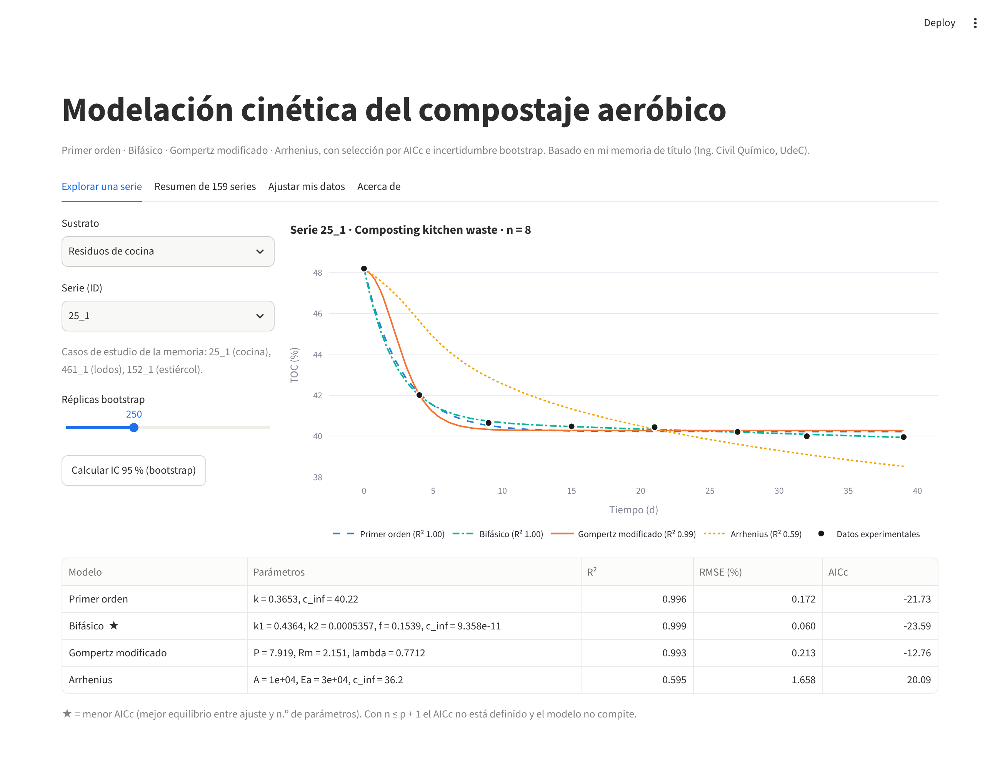
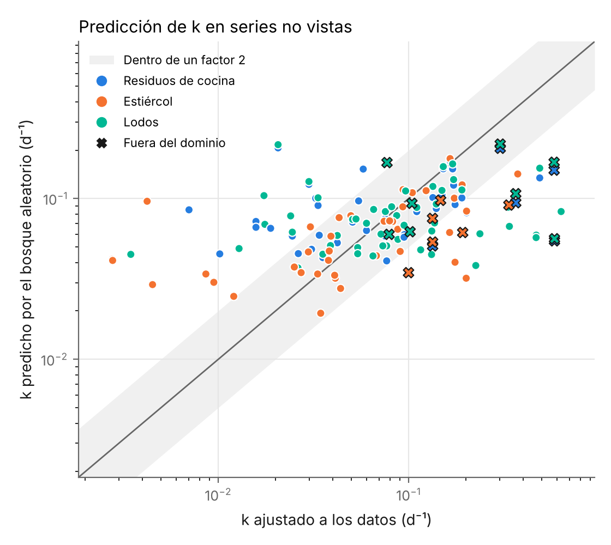
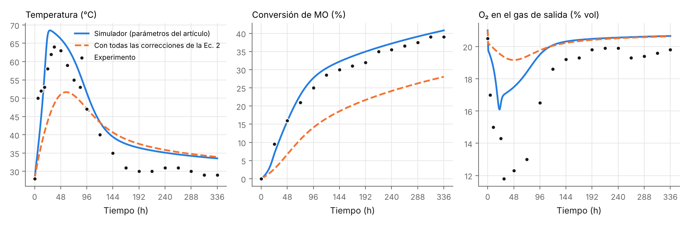
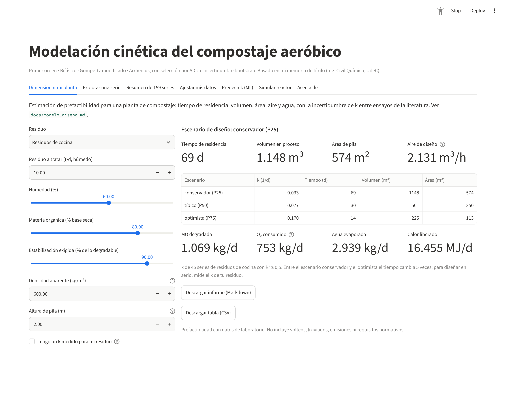
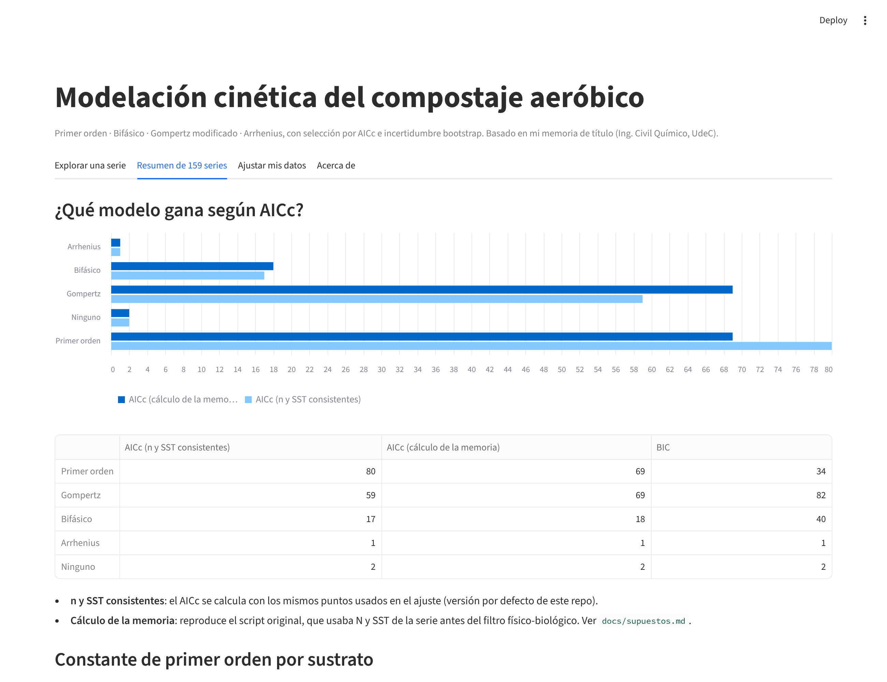

# Cinética del compostaje aeróbico

> Ajusta cuatro modelos cinéticos a curvas de degradación de compost, elige el mejor por AICc y estima la incertidumbre de sus parámetros, para dimensionar el tiempo de residencia de un reactor de compostaje.

[](https://github.com/vmunozicq/compostaje-cinetica/actions/workflows/ci.yml)
[](https://compostaje-cinetica.streamlit.app)
[](LICENSE)



**English summary.** Reproducible re-implementation of my chemical engineering thesis (Universidad de Concepción, 2025). It fits first-order, biphasic, modified Gompertz and non-isothermal Arrhenius kinetics to 159 composting series from a public dataset, ranks them by AICc and gives bootstrap confidence intervals for the rate constants. The code reproduces the thesis results exactly (same 159 series, R² identical to 10⁻⁶). Re-running it also exposed two errors in the original analysis. The repo now defaults to a corrected version: consistent AICc, time measured from the first sample, Arrhenius reparametrised around a reference temperature, and a residual bootstrap. All of it is documented in [`docs/supuestos.md`](docs/supuestos.md).

---

## 1. Problema

Para dimensionar un reactor o una pila de compostaje se necesita saber cuán rápido se degrada la materia orgánica de cada sustrato, y cuán confiable es esa velocidad. En la práctica se toma una constante de primer orden de algún artículo sin revisar si ese modelo describe bien el sustrato. Esta herramienta compara cuatro modelos sobre datos reales de residuos de cocina, estiércol y lodos. Elige el modelo con un criterio que penaliza los parámetros de más y entrega intervalos de confianza para diseñar de forma conservadora.

## 2. Modelo

C es el carbono orgánico total (TOC) o la materia orgánica (OM), en % base seca. C₀ es el primer dato medido y C∞ la fracción no degradable.

| Modelo | Ecuación | Parámetros (p) |
| --- | --- | --- |
| Primer orden | C(t) = C∞ + (C₀ − C∞) e^(−k t) | k, C∞ (2) |
| Bifásico | C(t) = C∞ + (C₀ − C∞) [f e^(−k₁ t) + (1 − f) e^(−k₂ t)] | k₁, k₂, f, C∞ (4) |
| Gompertz modificado | Y = C₀ − C = P exp{−exp[(Rm e / P)(λ − t) + 1]} | P, Rm, λ (3) |
| Arrhenius no isotérmico | dC/dt = −k_ref exp[−(Eₐ/R)(1/T(t) − 1/T_ref)] · (C − C∞) | k_ref, Eₐ, C∞ (3) |

| Símbolo | Significado | Unidad |
| --- | --- | --- |
| t | tiempo desde el primer dato medido (t − t₀) | d |
| k, k₁, k₂ | constantes de degradación | d⁻¹ |
| Rm, λ | velocidad máxima y fase de latencia (Gompertz) | %·d⁻¹, d |
| k_ref, Eₐ | constante a T_ref y energía de activación | d⁻¹, J·mol⁻¹ |
| T_ref | temperatura media medida en la serie | K |
| T(t) | temperatura medida, interpolada linealmente | K |

**Ajuste.** Mínimos cuadrados no lineales con cotas: `curve_fit` (Trust Region Reflective) para los tres primeros modelos y `least_squares` sobre el ODE para Arrhenius, con tres arranques de Eₐ.

**Selección.** AICc = n ln(SSE/n) + 2p + 2p(p + 1)/(n − p − 1). Solo compiten los modelos con R² > 0 y n > p + 1.

**Incertidumbre.** Bootstrap de residuos, B = 1000, con el IC 95 % por percentiles. El bootstrap de pares de la memoria también está disponible.

**Dos modos.** `modo="consistente"` (por defecto) aplica las correcciones descritas en la sección 4. `modo="memoria"` reproduce los scripts originales: C(0) = C₀ aunque la serie parta después, Arrhenius en la forma A·exp(−Eₐ/RT) con L-BFGS-B, y bootstrap de pares.

Fuentes: Saldarriaga et al. (2018) e Ibrić et al. (2021) para primer orden; Zwietering et al. (1990) para Gompertz. El detalle está en [`docs/modelo.md`](docs/modelo.md).

## 3. Supuestos y límites

- Humedad y oxígeno no son limitantes, así que la cinética depende solo de t, C y T.
- TOC u OM representan el sustrato degradable. Se usa TOC si la serie tiene al menos 5 datos de TOC.
- Filtro de calidad por punto: T entre 10 y 75 °C, humedad entre 30 y 75 %, pH entre 5,5 y 9, y C/N entre 8 y 40. Cada serie necesita al menos 5 puntos y una variación de al menos 2 puntos porcentuales.
- Errores homocedásticos e independientes.
- **No cubre** transferencia de calor y masa, aireación, balance de agua ni cinética microbiana explícita. Tampoco predice fuera del rango de los datos.
- **Datos públicos.** Se usa el [Compost Dataset](https://github.com/1191600618/Compost-Dataset) (Zhang et al., 2025, *Waste Management* 205, 114981), con licencia MIT y fijado a un commit con verificación SHA-256. Ver [`SOURCES.md`](SOURCES.md).

Las diferencias entre el texto de la memoria y los scripts que generaron sus resultados están en [`docs/supuestos.md`](docs/supuestos.md). Cuando difieren, el modo "memoria" sigue a los scripts.

## 4. Validación

El caso de validación consiste en reproducir, en modo "memoria", los resultados de mi memoria con el mismo dataset. Sus tablas originales están en `data/reference/`.

| Variable | Memoria | Este código | Diferencia |
| --- | ---: | ---: | --- |
| Series tras filtro físico | 417 | 417 | 0 |
| Puntos tras filtro físico | 3.362 | 3.362 | 0 |
| Series ajustables | 159 | 159 | mismos ID |
| R² primer orden, bifásico y Gompertz | 159 series | 159 series | < 10⁻⁶ |
| k de primer orden | 159 series | 159 series | < 10⁻⁵ |
| Ganadores AICc (cálculo original) | 71 / 69 / 18 / 1 | 69 (+2 sin ajuste) / 69 / 18 / 1 | ver nota |

El test que lo verifica es [`tests/test_validacion.py`](tests/test_validacion.py). El orden de los ganadores es primer orden / Gompertz / bifásico / Arrhenius.

Nota: el script original rotulaba como "primer orden" a las 2 series sin ningún ajuste válido. Aquí aparecen como "Ninguno".

### Lo que encontré al reproducirla

**1. El AICc de la memoria mezclaba dos versiones de cada serie.** El R² venía del ajuste con los datos filtrados, pero N y SST venían de la serie sin filtrar. Esto ocurre en 54 de 159 series.

**2. El bootstrap numeraba las series de otra forma.** El script no eliminaba una fila sin tiempo, así que la "25_1" de la figura de incertidumbre era otra serie.

**3. El modelo suponía que todas las series parten en t = 0.** C₀ es el primer dato, pero 58 de las 159 series empiezan después del día 0, algunas en el día 14. El modelo forzaba C(t = 0) = C₀ e inventaba una caída anterior al primer dato. Ahora el tiempo se mide desde el primer dato. Con eso el R² de la serie de lodos 461_1 sube de 0,90 a 0,98 y su k pasa de 0,20 a 0,34 d⁻¹.

**4. El ajuste de Arrhenius no se movía del punto de partida.** En 156 de las 159 series, L-BFGS-B terminaba en los valores iniciales (A = 10⁴ d⁻¹, Eₐ = 30 kJ/mol), porque A y Eₐ se compensan y con escalas tan distintas el gradiente numérico casi no cambia nada. Los resultados de Arrhenius de la memoria reflejan esos valores iniciales, no un ajuste. Con la temperatura de referencia, el R² mediano de Arrhenius sube de 0,85 a 0,96.

| Mejor modelo (AICc) | Memoria | Solo corrigiendo el AICc | Versión corregida |
| --- | ---: | ---: | ---: |
| Primer orden | 69 (+2) | 80 | 86 |
| Gompertz | 69 | 59 | 40 |
| Bifásico | 18 | 17 | 21 |
| Arrhenius | 1 | 1 | 10 |
| Sin ajuste válido | — | 2 | 2 |

La conclusión de la memoria se mantiene: ningún modelo es universal. Pero el primer orden es el mejor punto de partida en más de la mitad de las series. Parte de las series que ganaba Gompertz se explicaban porque su latencia λ absorbía el error del origen del tiempo. Arrhenius gana en 10 series, con Eₐ entre 25 y 100 kJ/mol. En 34 series Eₐ queda en la cota inferior: los datos no muestran dependencia de la temperatura.

| Resultado | Memoria | Versión corregida |
| --- | --- | --- |
| Mediana de k, cocina / estiércol / lodos (d⁻¹) | ≈0,12 (solo cocina) | 0,076 / 0,074 / 0,081 |
| Mediana de λ, cocina / estiércol / lodos (d) | lodos > 3, cocina → 0 | 1,8 / 0,45 / 0,85 |
| Serie 25_1 (caso de cocina) | primer orden | gana el bifásico (R² 0,999) |
| IC 95 % de k, serie 25_1 (d⁻¹) | 0,018–0,087 (otra serie) | 0,33–0,42 |

Con la corrección, la constante de primer orden es parecida en los tres sustratos (mediana ≈ 0,08 d⁻¹). La dispersión dentro de cada sustrato es mayor que la diferencia entre ellos.


### Más allá de la memoria: ¿se puede predecir k sin ensayo?

La memoria dejó fuera de alcance el aprendizaje automático y la predicción fuera del rango de los datos. Se entrenó un bosque aleatorio que predice k a partir del sustrato, el pH, el C/N, la humedad inicial y la temperatura media. Está validado con series que no vio y con un sustrato completo dejado fuera ([`docs/modelo_ml.md`](docs/modelo_ml.md)).

| Validación | R² | Predicciones dentro de un factor 2 |
| --- | ---: | ---: |
| Series nuevas | 0,17 | 60 % |
| Sustrato nuevo | −0,21 | 54 % |

Las condiciones iniciales explican poco de k: un modelo entrenado con la literatura sirve como primera estimación, pero para diseñar hay que medir la cinética del sustrato real. Un dominio de aplicabilidad avisa cuando la entrada se aleja de los datos de entrenamiento. Fuera de él, el error típico es un factor 2,6; dentro, un factor 1,6.



### Más allá de la memoria: simulador de reactor

La memoria tampoco cubrió la transferencia de calor y masa, la aireación ni el balance de agua. El simulador implementa el modelo de Petric y Selimbašić (2008, doi [10.1016/j.cej.2007.08.017](https://doi.org/10.1016/j.cej.2007.08.017)) para un reactor de 32 L con aireación forzada. Resuelve diez ecuaciones diferenciales acopladas: materia orgánica, agua, O₂ y CO₂ en el sólido y en el gas, y las temperaturas del sustrato y del gas ([`docs/modelo_reactor.md`](docs/modelo_reactor.md)).

Frente al experimento 2 del artículo (datos digitalizados de sus figuras), el error cuadrático medio es de 5,8 °C en temperatura, 1,9 puntos en conversión y 2,7 puntos en O₂. Con los parámetros cinéticos publicados, el experimento solo se reproduce aplicando la corrección por temperatura; con las cuatro correcciones de la cinética, el modelo subpredice (hallazgo H-1).

| Caudal de aire (m³/h) | T máx (°C) | Horas ≥ 55 °C | Conversión 14 d (%) | O₂ mín (%) |
| ---: | ---: | ---: | ---: | ---: |
| 0,06 | 71,4 | 144 | 44,6 | 6,2 |
| 0,10 | 70,6 | 110 | 43,2 | 12,0 |
| 0,18 | 68,5 | 70 | 40,8 | 16,1 |
| 0,26 | 65,5 | 47 | 38,8 | 17,7 |

Más aire enfría y seca el material: acorta la fase termófila, pero mantiene el O₂ lejos de condiciones anóxicas.



### Para qué sirve: dimensionar una planta

La pestaña **Dimensionar mi planta** une las tres partes anteriores. Entras toneladas por día de residuo, humedad, materia orgánica y la estabilización que se busca, y entrega el tiempo de residencia, el volumen, el área de pila, el aire, el O₂, el agua evaporada y el calor, más un informe descargable ([`docs/modelo_diseno.md`](docs/modelo_diseno.md)).

Para 10 t/d de residuo de cocina y una estabilización del 90 %, el tiempo de residencia va de 14 a 69 días según el k del sustrato (P75 a P25 de 45 ensayos). Esa dispersión de 5 veces es el argumento para medir la cinética del residuo real antes de construir.



## 5. Demo

App en línea: **https://compostaje-cinetica.streamlit.app** (si está dormida, pulsa el botón para despertarla; tarda unos 30 s).

La app tiene estas pestañas:

- **Dimensionar mi planta**: tiempo de residencia, volumen, área, aire y agua para tu caudal de residuo, con escenarios conservador, típico y optimista e informe descargable.
- **Explorar una serie**: elige un sustrato y una serie, compara los cuatro ajustes en la versión corregida o como en la memoria, y calcula el IC 95 % de k, Rm y λ con bootstrap de residuos o de pares.
- **Resumen de 159 series**: ganadores por criterio y distribución de k por sustrato.
- **Ajustar mis datos**: pega un CSV con `t`, `C` y opcionalmente `T`, y obtén los cuatro ajustes con su AICc.
- **Predecir k (ML)**: estima k para un sustrato y unas condiciones, y avisa si la entrada está fuera del dominio de los datos.
- **Simular reactor**: cambia caudal de aire, humedad, masa y temperaturas, y ve la temperatura, la conversión, el O₂ y la humedad en 14 días.
- **Acerca de**.

| Resumen | Ajustar mis datos |
| --- | --- |
|  |  |

### Ejecutar en local

```bash
git clone https://github.com/vmunozicq/compostaje-cinetica.git
cd compostaje-cinetica
python -m venv .venv && source .venv/bin/activate
pip install -r requirements.txt -r requirements-dev.txt
pytest
streamlit run app/streamlit_app.py
```

Para regenerar todos los resultados y figuras en ambos modos (unos 4 minutos):

```bash
python scripts/run_pipeline.py --boot 1000
```

## 6. Estructura

```
src/compostaje/   núcleo: datos, modelos, métricas, ajuste, bootstrap (sin Streamlit)
app/              interfaz Streamlit
scripts/          pipeline que genera results/ y docs/figuras/
tests/            pytest: unidades + reproducción de la memoria
data/raw/         Compost Dataset tal como se descargó (ver SOURCES.md)
data/reference/   tablas originales de la memoria, para validar
results/          ajustes por serie, ganadores y bootstrap
docs/             modelo, supuestos y discrepancias, figuras
```

## 7. Hecho con Claude Code

Este es un proyecto personal. El modelo es mío: las ecuaciones, los supuestos y los filtros vienen de mi memoria de título y de los scripts con que la hice ([`docs/modelo.md`](docs/modelo.md)). [Claude Code](https://claude.com/claude-code) reescribió ese análisis como un paquete con tests y una interfaz, lo comparó contra mis tablas originales y documentó cada diferencia en vez de corregirla en silencio.

## Licencia y cita

Código bajo licencia [MIT](LICENSE). El Compost Dataset conserva su licencia MIT original ([`data/raw/LICENSE-Compost-Dataset`](data/raw/LICENSE-Compost-Dataset)).

Memoria: Muñoz, V. (2025). *Modelación cinética multimodelo del compostaje aeróbico de sólidos a partir de literatura: ajuste de parámetros y guía para diseño experimental.* Memoria de título, Ingeniería Civil Química, Universidad de Concepción. Profesor guía: Dr. Claudio Zaror Z.

Proyecto personal de Vicente Muñoz, Ingeniero Civil Químico. [LinkedIn](https://www.linkedin.com/in/vicente-mu%C3%B1oz-748aa2230) · [Otros proyectos](https://github.com/vmunozicq)
